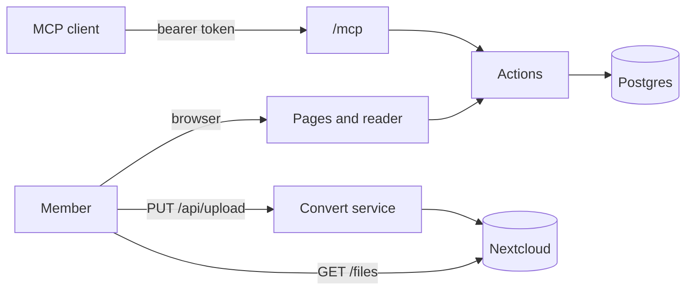

```
██╗   ██╗██╗███████╗██╗    ██╗███████╗██████╗
██║   ██║██║██╔════╝██║    ██║██╔════╝██╔══██╗
██║   ██║██║█████╗  ██║ █╗ ██║█████╗  ██████╔╝
╚██╗ ██╔╝██║██╔══╝  ██║███╗██║██╔══╝  ██╔══██╗
 ╚████╔╝ ██║███████╗╚███╔███╔╝███████╗██║  ██║
  ╚═══╝  ╚═╝╚══════╝ ╚══╝╚══╝ ╚══════╝╚═╝  ╚═╝
```

# WinLab Viewer

> Read lab documents together: PDF, Word and PowerPoint in one reader, marks and sticky-note comments that update live, and every action also an MCP tool.

`nextjs` `postgres` `nextcloud` `pdfjs` `docker` `mcp`

[](https://github.com/NYCU-WinLab/viewer/actions) &nbsp;[](https://github.com/NYCU-WinLab/viewer/pkgs/container/viewer) &nbsp;[](#license)

WinLab members upload a paper draft, a report or a deck, share it with the people who should read it, and mark it up together. Each mark carries a sticky note: a thread of comments with names and times, where edited comments keep their earlier wording.

```
> "What is still open on the proposal?"
  ⚡ list_annotations { "id": "01e3…", "version": 2 }
✓ [{ "tool": "box", "page": 1, "author": "alice", "resolvedAt": null, "comments": [{ "body": "這段要改寫" }] }]
```

## What it does

- **Lists your documents**: your own and the ones shared with you, with how many marks are still open.
- **Reads PDF, Word and PowerPoint**: docx and pptx turn into PDF at upload, with stand-in fonts at the same widths (Calibri, Times New Roman, Arial, DFKai-SB).
- **Marks with 3 tools**: a highlighter on text, a box over any area (a figure, a table, a slide object) and a pen.
- **Keeps a sticky note on every mark**: comments with author and time, edit history, and a button that marks it resolved.
- **Keeps versions**: upload a new file to the same document; every version stays readable with its own marks.
- **Shares per member**: view, comment or edit.
- **Updates live**: a mark or comment from anyone shows on every open page.
- **Serves MCP** at `/mcp`, with the viewer as the OAuth 2.1 authorization server.

## Deploy

With Docker Compose, on any machine with Docker:

```sh
curl -fsSLO https://raw.githubusercontent.com/NYCU-WinLab/viewer/main/compose.yaml
curl -fsSL -o .env https://raw.githubusercontent.com/NYCU-WinLab/viewer/main/.env.example
# set POSTGRES_PASSWORD, BETTER_AUTH_*, KEYCLOAK_* and NEXTCLOUD_* in .env
docker compose up -d
```

This starts Postgres and the convert service, runs the migrations once, then serves the viewer from `ghcr.io/nycu-winlab/viewer` on `127.0.0.1:3000`.

> [!IMPORTANT]
> Put a reverse proxy with TLS in front, at the host in `BETTER_AUTH_URL`, and let it pass request bodies of 100 MB. MCP clients only accept an HTTPS resource, and the Keycloak redirect URI must match it.

viewer.winlab.tw deploys on every push to `main`. The release workflow retags the images ci built, then sends a Carrel app release (`winfra/viewer`). On the machine, carrel-deployd runs [deploy/carrel-start.sh](deploy/carrel-start.sh): it sets `VIEWER_VERSION` in `/opt/viewer/.env` and waits until web is healthy. A failed health check rolls back to the previous release.

## Use

1. In your Keycloak realm, create a confidential OpenID Connect client with the redirect URI `<BETTER_AUTH_URL>/api/auth/callback/keycloak`, and put its ID and secret in `.env`. Give its service account `view-users`, so sharing can list lab members and `/mcp` can check that a member still exists.
2. In Nextcloud, create an app password for the account that holds the files, create the folder `NEXTCLOUD_ROOT` in it, and put both in `.env`.
3. Open `BETTER_AUTH_URL`, sign in and press Upload (上傳) in the top right.
4. Add the MCP server to a client, for example `claude mcp add --transport http viewer <BETTER_AUTH_URL>/mcp`, then ask it to call `whoami`.

## Configure

Set these in `.env`; [.env.example](.env.example) documents every one.

| Key | What it sets | Default |
|-----|--------------|---------|
| `POSTGRES_PASSWORD` | The database password, used by every service | required |
| `BETTER_AUTH_URL` | The public URL; the MCP resource is `<url>/mcp` | required |
| `BETTER_AUTH_SECRET` | Signs sessions and OAuth queries | required |
| `KEYCLOAK_ISSUER` | The realm URL, e.g. `https://auth.example.com/realms/lab` | required |
| `KEYCLOAK_CLIENT_ID`, `KEYCLOAK_CLIENT_SECRET` | The viewer's Keycloak client | required |
| `NEXTCLOUD_URL`, `NEXTCLOUD_USER`, `NEXTCLOUD_APP_PASSWORD` | Where the files live | required |
| `NEXTCLOUD_ROOT` | The folder in that account the viewer owns | `viewer` |
| `PORTAL_URL`, `PORTAL_SERVICE_KEY` | Where guest invitations are mailed from: a portal service key allowed to send invitations; no mail when empty | `https://portal.winlab.tw`, empty |
| `VIEWER_VERSION` | Image tag | `main` |
| `VIEWER_BIND`, `VIEWER_PORT` | Where web listens on the host | `127.0.0.1`, `3000` |
| `OTEL_EXPORTER_OTLP_ENDPOINT` | OTLP/HTTP endpoint for traces and error logs; off when empty | empty |

## How it works



An upload streams to a temp file. A docx or pptx goes to the convert service (Gotenberg, LibreOffice inside) and comes back as PDF. Both files go to Nextcloud as `<root>/<document id>/v<n>.<ext>` and `v<n>.pdf`; only then is the version row written. The reader loads `/files/<id>/<n>` (access checked, streamed from Nextcloud) into pdf.js, which draws each page on a canvas with a selectable text layer. Marks are stored in page fractions, so they hold at any zoom. Only `lib/actions`, `lib/auth` and `lib/db` touch the database, and CI checks that every action is in the registry the MCP tools come from.

## Develop

```sh
bun install
cp .env.example .env.local   # point DATABASE_URL at a local Postgres, CONVERT_URL at Gotenberg
docker build -t viewer-convert convert && docker run -d -p 3001:3000 viewer-convert
bun run db:migrate
bun run dev
```

CI runs typecheck, lint, format, the design token check, the action registry check and a build, then builds both images and probes a real `docker compose up`. See [CLAUDE.md](CLAUDE.md) for the conventions.

## Limits

- Conversion is close, not exact: fonts are stand-ins, and pptx animations and some effects are lost.
- A mark belongs to the version it was drawn on; carrying open marks to a new version is not built yet.
- Sharing is per member; groups and share links are not built yet.

## License

[MIT](LICENSE), made in a lab that reads every draft twice.
